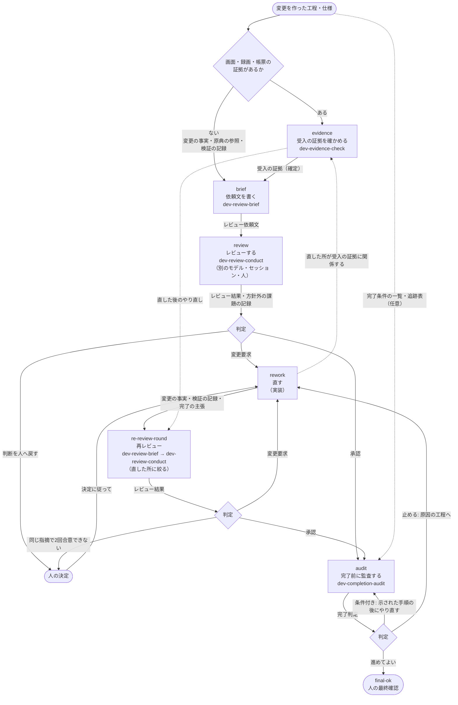
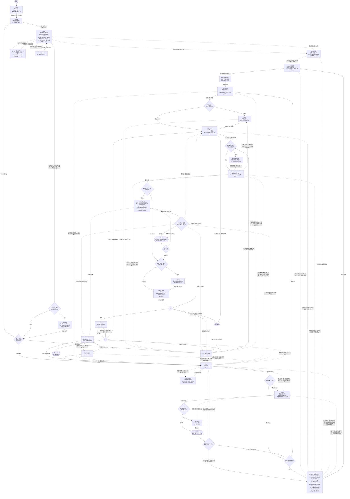
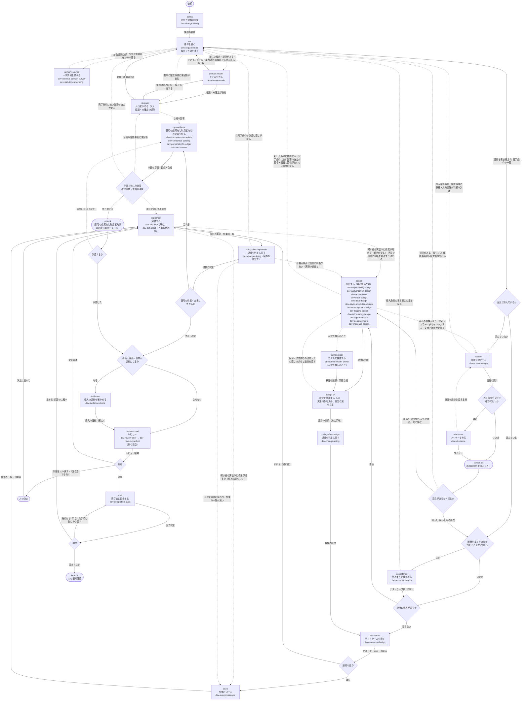
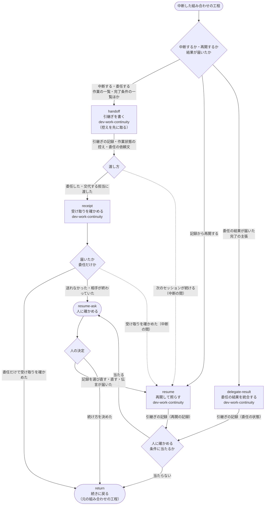
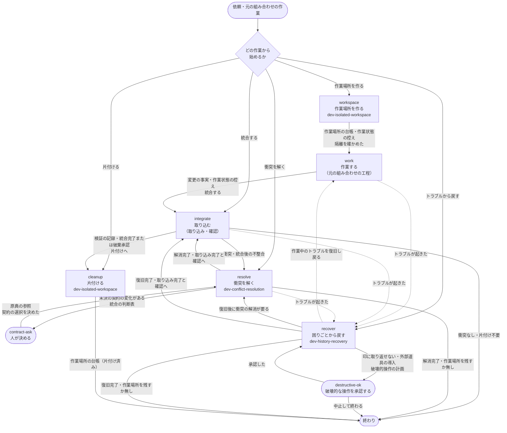
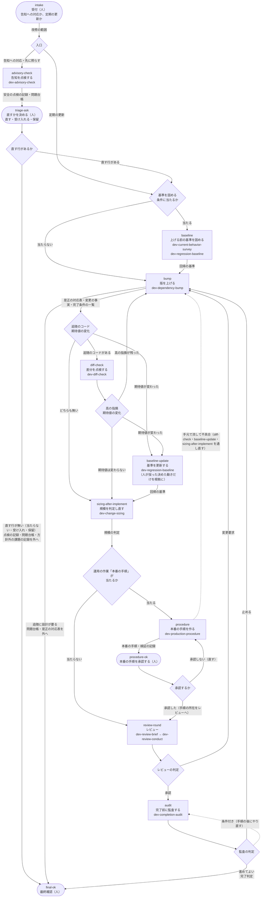
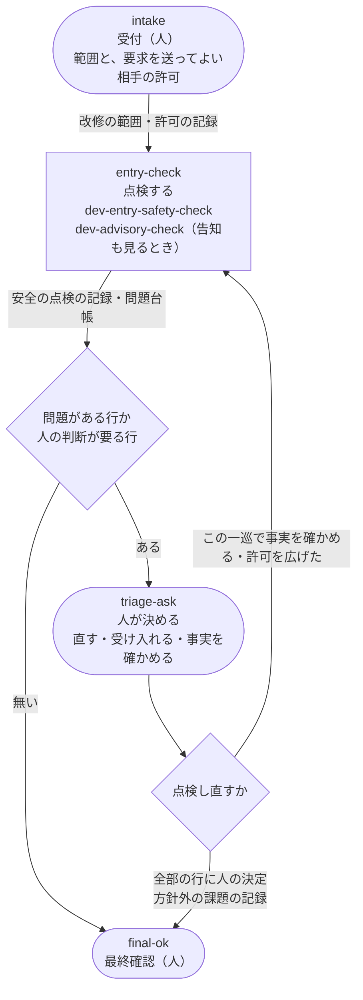
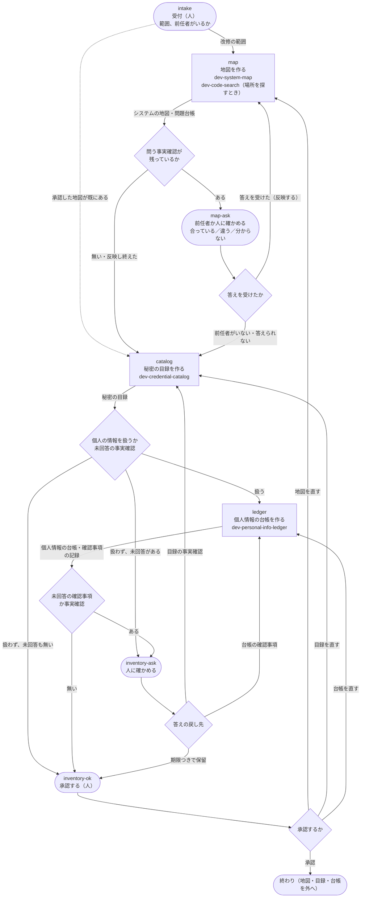
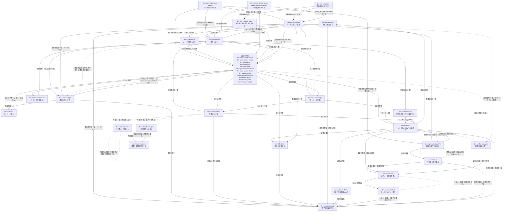

# 開発スキル群の流れ図

プロファイルごとに、どの順で単位を使い、何を受け取って何を渡し、どの条件で次へ進むかを図にしたもの。正本は各プロファイルの SKILL.md の「工程」「遷移」「振り分け」「工程の間の決まり」で、この図はそれを読みやすくした写し。プロファイルを直したら、この図も直す。図の矢印は、判定と人の決定をたたむと、プロファイルの「遷移」の表と一致する（`scripts/check_dev_flows.py` で確かめる）。

図の見方:

- 四角は工程。1行目は工程の識別子（プロファイルの工程の表の1列目）、2行目は工程の名前。`dev-` の名前があるものは単位を使う工程、「（人）」は単位を使わない工程。
- 矢印の上の文字は、渡す成果物の型か、進む条件。
- ひし形は判定。

## 1. レビューの一巡（`dev-profile-review-cycle`）

決まり:

- `brief` と `review`（`re-review-round` の中の依頼文とレビューも）を、同じセッションで続けて行わない。
- 受入の証拠は確定してから依頼文に添える。確定の後に関係する所を変えたら、`evidence` をやり直す。
- 「判断を人へ戻す」の間も、決定待ちの事柄以外の作業は止めない。

### 入口（一言の依頼から入る工程）

| 依頼の言い方・状況 | 入る工程 |
|---|---|
| このセッションが作った変更を「レビューに出したい」「レビューして」「直したのでレビューして」 | `brief`（証拠があれば `evidence` から） |
| レビュー依頼文を渡された、またはこのセッションが作っていない変更を「レビューして」「このPRを見て」 | `review` |
| レビュー結果を受けて「直したので見て」「再レビューして」 | `re-review-round` |
| 「終わったか確認して」「人に見せてよいか」 | `audit` |

## 2. 既存システムの改修（`dev-profile-existing-system`）

判定の中身:

| 判定 | 結果ごとの工程 |
|---|---|
| A. 既存の利用側がある処理（共有の処理、外部との連携）に触るか | 触るなら `survey` と `baseline` |
| B. 不具合を直すのか、機能を変えるのか | 不具合なら `fix`、機能の変更なら `req`、`test-design`、`implement`。両方あれば分けて進める |
| C. 仕様書が無い・信用できない、または原因の切り分けに今の動きの把握が要るか | 当たれば `survey`。仕様書が無いときは、人が確かめた問題台帳と現状の振る舞いの記録を、その後の工程の原典の参照にする |
| 作業に分ける条件 | 通常の道、B が両方、設計の判断に波及や順序の制約がある、同じ形の箇所をまとめて直す承認がある、並べて進める。どれかに当たれば `tasks` |

`formal-check`・`data-audit`・`survey-ask` は `survey` から寄り道して `survey` に戻り、`primary-source`・`domain-model`・`req-ask` は `req` から寄り道して `req` に戻る。`screen`・`wireframe`・`screen-ok` は本線で、要件を書き終え、仕様化を終えるときの検査を通した後にだけ入り、`screen` の後は必ず `screen-ok` を通る。既存の画面を踏襲するときは、`screen` で踏襲する範囲の表を人と合意してから差分だけを設計する。`screen-ok` の意見はどれも `req` で確認事項の記録の行にして振り分ける。`design` は、規模の判定が要るとした観点の単位だけを、責務の配置 → 認可 → システム間の連携 → データ → エラー → デザインシステム → 非同期の実行 → 文面 → ログ → 呼ばれる契約 → 応答と入口の安全 → エージェント向けの契約 の順に使う。是正（`fix`）の方針が契約・エラー・データ・非同期の実行・システム間の連携を変えると分かったら、是正を止め、B を機能の変更に切り替えて `req` へ進む。是正で作業に分ける条件に当たったら、`test-design` でテストケース表を作り、`tasks` で分けてから作業ごとに `fix` を進める。モデルの検査（`formal-check`）は、今の実装を対象なら `survey` の中で、`design` の設計を対象なら `design` の後に行い、反例の扱いは `design-ok` で人が決める。`test-design` の `dev-acceptance-e2e` は、画面をまたぐ流れが変わるか、既存の E2E がある処理の状態や導線を変えるときに使う。

決まり:

- `baseline` は、`fix`・`implement` より前に通す。確定した重要な不具合で急ぐときは、是正と並べて固め、`audit` の前に是正の前の版で通したことを確かめる。
- 基準を通すために動きを直したり、期待値を黙って変えたりしない。期待値は `baseline-update` で、区分と根拠を付けて変える。
- 業務規則が変わるときは、モデルを先に直し（`domain-model`）、要件はそれを根拠に書く（`req`）。今の画面でできることを、要件の根拠にしない。仮説・未確定の業務規則（`survey` で抜き出した候補、一次情報から推定したものを含む）を要件と設計の根拠にせず、`domain-model`・`req-ask` で確定させる。業務規則の回答は、どの結果でも `domain-model` で一覧に反映する。`req` を終える前に型の一覧の「仕様化を終えるときの検査」を、`design` を終える前に「設計を終えるときの検査」を通す。
- 規模の判定は `sizing`、原因や設計が固まった時（`sizing-after-design`）、`sizing-after-implement`（実際の差分で）の3回行う。作業に分けて道が変わったときも判定し直す。道の正本は最新の規模の判定で、`tasks` を行ったら通常の道。
- 設計の判断に人の決定待ちが残っている作業は始めない。モデルの検査とデータの規則違反の監査は人が依頼するまで始めない。
- E2E の範囲を縮めること（既存の E2E の廃止を含む）は、人の承認を待つ。
- 受入の証拠は確定してから `review-round` と `audit` に回す。確定の後に関係する所を変えたら、`evidence` をやり直す。
- 同じ範囲に是正・人の判断・調べが残っていれば、`audit` へ進めない。
- `implement`（と、`tasks` で分けた是正の `fix`）の差分の点検は、実装した側の点検で、`review-round` のレビューの代わりにしない。依頼文に写すのは、点検した範囲と見なかった観点だけ。設計の判断と違う実装は判断に合わせ、判断を見直すと人が決めたら `design` に戻る。

### 入口（一言の依頼から入る工程）

| 依頼の言い方・状況 | 入る工程 |
|---|---|
| 「この不具合を直して」 | `intake` → `sizing` → `fix`（A か C に当たれば `survey`・`baseline` を先に） |
| 「この課題を進めて」 | `intake` → `sizing`（B を判定してから `fix` か `req` → `test-design` → `implement`） |
| 「既存システムに新しい機能を足したい」 | `intake` → `sizing` → `req` → `design`（要るとき）→ `test-design` → `tasks`（条件に当たれば）→ `implement`（A に当たれば `survey`・`baseline` を先に） |
| 「この変更の要件を書いて」「要望との差を要件にして」 | `req` |
| 「既存のコードから業務規則を洗い出して」 | `survey`（業務規則の抽出） |
| 「今の画面を踏襲して差分だけ設計して」「この画面の流れを変えたい」 | `intake` → `sizing` → `req` → `screen`（今の画面の記録が無ければ `survey` を先に） |
| 「ワイヤーを作って」「画面のたたき台を見せられる形にして」 | `wireframe`（画面の設計が無ければ `screen` から） |
| 「既存のデザインシステムに合わせて」「この部品の仕様を決めて」 | `design`（デザインシステム） |
| 「既存のデータが規則を守っているか調べて」 | `data-audit` |
| 「この権限を変えたい」「組織をまたいでデータが見えないようにしたい」 | `intake` → `sizing` → `survey` → `req` → `design`（認可） |
| 「既存のアプリに MCP サーバーを組み込みたい」 | `intake` → `sizing` → `req` → `design`（認可とエージェント向けの契約） |
| 「もう直ってるはず」「再現しないと言われた」 | `fix`（現実の確認から） |
| 「同じような不具合がほかにないか見て」 | `fix`（同じ形の箇所の探索だけ） |
| 「既存の動きを壊さずに直したい」「改修前に今の動きを固めておきたい」 | `intake` → `survey`（記録が無ければ）→ `baseline` |
| 「今どう動いているか調べて」「現状の仕様を洗い出して」 | `survey` |
| 「〜の処理はどこ？」「この関数を変えると、どこに影響する？」 | `survey`（場所の探索だけ。通しの調査や台帳は作らない） |
| 「この共通処理を変えたい」「この外部連携を作り直したい」「既存システムを改修したい」 | `intake` → `sizing` → `survey` → `baseline` |
| 「期待値が変わったけどテストを直していい？」 | `baseline-update` |
| 「コミットの前に差分を点検して」「この作業の実装が設計どおりか確かめて」 | `implement`（作業の終わりの点検） |
| 「この録画を提出していい？」「画面の証拠を確かめて」 | `evidence` |
| 「直したのでレビューして」 | `review-round` |
| 「もう閉じていい？」 | `audit` |

## 3. 新規開発（`dev-profile-new-feature`）

決まり:

- 完了条件の一覧には、項目ごとの識別子を書き、道はどの規模の判定に従うかを指す（道の正本は最新の規模の判定）。
- `primary-source`・`domain-model`・`req-ask` は `req` から寄り道して `req` に戻る。業務規則が変わるときは、モデルを先に作り（`domain-model`）、要件はそれを根拠に書く。仮説・未確定の業務規則（一次情報から推定したものを含む）を要件と設計の根拠にせず、`domain-model`・`req-ask` で確定させる。業務規則の回答は、どの結果でも `domain-model` で一覧に反映する。`req` を終える前に型の一覧の「仕様化を終えるときの検査」を、`design` を終える前に「設計を終えるときの検査」を通す。
- `design` の単位は、要るものを 責務の配置 → 認可 → システム間の連携 → データ → エラー → デザインシステム → 非同期の実行 → 文面 → ログ → 呼ばれる契約 → 応答と入口の安全 → エージェント向けの契約 の順に使う。後の単位が前の判断の前提を変えたら、前の判断を直して承認の状態を戻す。
- 画面の工程（`screen`・`wireframe`・`screen-ok`）には、要件を書き終え、仕様化を終えるときの検査を通した後にだけ入る。`screen` の後は必ず `screen-ok` を通る。`screen-ok` の意見はどれも `req` で確認事項の記録の行にして振り分け、画面やワイヤーだけで直さない。採った版の所在を、原典の参照として下流に渡す。
- 設計の判断に人の決定待ちが残っている作業は始めない。モデルの検査は人が依頼するまで始めない。反例の扱いは `design-ok` で人が決める。
- 道が軽い道から通常の道に変わったら（`sizing-after-design`、作業に分けた後、軽い道の実装中のどれでも）、実装を止めて `design` と `tasks` を通す。
- `sizing-after-implement` の判定は、承認し直し（①）→ 要る観点の設計（②）→ 作業の一覧（③）→ 通常の続行 の順に見る（図の矢印の番号）。
- 受入の証拠は確定してから `review-round` と `audit` に回す。E2E の範囲を縮めることは、人の承認を待つ。
- 型の一覧の「道に応じた検査」が通らない項目が残っていれば、`audit` で「進めてよい」にしない。
- `implement` の差分の点検は、実装した側の点検で、`review-round` のレビューの代わりにしない。依頼文に写すのは、点検した範囲と見なかった観点だけ。設計の判断と違う実装は判断に合わせ、判断を見直すと人が決めたら `design` に戻る。

### 入口（一言の依頼から入る工程）

| 依頼の言い方・状況 | 入る工程 |
|---|---|
| 「新しい機能を作りたい」「新規開発を進めて」 | `sizing` から |
| 「要件は決まったので設計して」 | `sizing`（完了条件の一覧を入力に）→ `req`（受けて確かめるだけ）→ `design` |
| 「要望から要件を起こして」「受入条件を書いて」 | `req` |
| 「ドメインモデルを作って」「業務の用語と規則を整理して」 | `domain-model` |
| 「この外部 API の仕様を調べて」「この計算が法令どおりか確かめて」 | `primary-source` |
| 「画面設計をして」「画面一覧を作って」「画面遷移を決めて」 | `screen`（完了条件の一覧が無ければ `sizing` から） |
| 「ワイヤーを作って」「画面のたたき台を見せられる形にして」 | `wireframe`（画面の設計が無ければ `screen` から） |
| 「デザインシステムを作って」「トークンを整理して」「この部品の仕様を決めて」 | `design`（デザインシステム） |
| 「タスクに分けて」「作業計画を立てて」 | `tasks`（テストケース表が無く通常の道なら `test-cases` を先に） |
| 「この機能のテストを洗い出して」 | `test-cases` |
| 「テストを先に書いて実装して」 | `implement` |
| 「コミットの前に差分を点検して」「この作業の実装が設計どおりか確かめて」 | `implement`（作業の終わりの点検） |
| 「形式手法で確かめて」 | `formal-check` |
| 「誰がこの操作をできるか決めて」「他人のデータが見えないようにしたい」 | `design`（認可） |
| 「アプリに MCP サーバーを組み込みたい」 | `sizing` から（`design` でエージェント向けの契約） |
| 「直したのでレビューして」 | `review-round` |
| 「もう閉じていい？」 | `audit` |

## 4. 中断と再開（`dev-profile-interrupt-resume`）

### 入口（一言の依頼から入る工程）

| 依頼の言い方・状況 | 入る工程 |
|---|---|
| 「ここで中断して、続きは次にやる」「次のセッションに引き継いで」 | `handoff` |
| 「この作業を別の担当に頼みたい」「この部分を委任して」 | `handoff`（委任の依頼文を書く） |
| 「続きから再開して」「前のセッションの続きをやって」（引継ぎの記録がある） | `resume` |
| 「続きをやって」（記録が見つからない） | `resume`（推定して `resume-ask` へ） |
| 「頼んでいた作業の結果が届いた」「委任先の報告をまとめて」 | `delegate-result` |

## 5. 版管理の作業（`dev-profile-version-control`）

### 入口（一言の依頼から入る工程）

| 依頼の言い方・状況 | 入る工程 |
|---|---|
| 「worktree で進めたい」「並列で安全に作業したい」「別の作業場所を作って」 | `workspace` |
| 「終わったので本線に取り込んで」「別の枝を統合したい（衝突はまだ無い）」 | `integrate` |
| 「コンフリクトを解消して」「rebase で衝突した」「取り込みで衝突や食い違いが出た」「両方残して統合するか判断して」 | `resolve` |
| 「push が拒否された」「大きいファイルをコミットしてしまった」「秘密をコミットに含めてしまった」「detached HEAD になった」「直前のコミットを取り消したい」 | `recover` |
| 「worktree を片付けて」 | `cleanup` |

## 6. 依存の更新（`dev-profile-dependency-upkeep`）

### 入口（一言の依頼から入る工程）

| 依頼の言い方・状況 | 入る工程 |
|---|---|
| 「この脆弱性の告知に対応して」「この CVE はうちに当たる？」 | `intake` → `advisory-check` |
| 「依存の脆弱性を定期的に点検して」 | `intake` → `advisory-check`（直すと決めた行があれば `baseline` か `bump` へ） |
| 「依存を定期的に更新したい」「この部品を最新にして」 | `intake` → `baseline` か `bump`（告知を先に照らすなら `advisory-check`） |
| 「この版に上げて」（行き先の版が決まっている） | `intake` → `baseline` か `bump` |
| 「ロックを作り直して」 | `intake` → `bump` |
| 「上げたのでレビューして」 | `review-round` |
| 「もう閉じていい？」 | `audit` |

## 7. 今の状態の安全の点検（`dev-profile-exposure-sweep`）

### 入口（一言の依頼から入る工程）

| 依頼の言い方・状況 | 入る工程 |
|---|---|
| 「今の公開サイトの安全の設定を点検して」「管理画面のヘッダと Cookie を見て」 | `intake` → `entry-check` |
| 「走査の道具の指摘を仕分けて」 | `intake` → `entry-check` |
| 「直したので点検し直して」 | `intake` → `entry-check`（前回の点検の記録を入力にする） |
| 「この指摘は受け入れていい？」 | `triage-ask` |

## 8. 引き継いだシステム（`dev-profile-inherited-system`）

### 入口（一言の依頼から入る工程）

| 依頼の言い方・状況 | 入る工程 |
|---|---|
| 「前任者から引き継いだシステムの現状を把握したい」「保守を引き継いだので、どこに何があるか整理したい」 | `intake` → `map` |
| 「ドキュメントの無いシステムの地図を作って」 | `intake` → `map` |
| 「引き継いだシステムの秘密を、値を見ずに一覧にして」 | `intake` → `map` → `catalog`（地図が既にあれば `intake` → `catalog`） |
| 「引き継いだシステムの個人情報の台帳を作って」 | `intake` → `map` → `catalog` → `ledger`（地図が既にあれば `intake` → `catalog` → `ledger`） |
| 「前任者の回答が届いた」 | `map-ask` か `inventory-ask` |

## 9. 単位の入力と出力

プロファイルを使わずに単位だけを使うときの早見表。型の中身は [型の一覧](../skills/dev-shared/references/artifact-types.md) を見る。

| 単位 | 必須の入力 | 条件付き・任意の入力 | 出力 |
|---|---|---|---|
| `dev-change-sizing` | — | 改修の範囲（既存を変えるとき）、完了条件の一覧、原典の参照、作業の一覧、設計の判断、変更の事実（終わる時） | 規模の判定 |
| `dev-requirements` | 原典の参照 | ドメインモデル、業務規則の一覧、一次情報の記録（公的な規則や外部の仕様が基準のとき）、現状の振る舞いの記録（既存を変えるとき）、問題台帳、規模の判定、確認事項の記録、完了条件の一覧（直すとき・受けるとき）、画面の設計（返された案を採否するとき） | 完了条件の一覧、確認事項の記録、問題台帳 |
| `dev-screen-design` | 完了条件の一覧 | 原典の参照、ドメインモデル、業務規則の一覧、設計の判断（認可・エラー・デザインシステム・文面の判断があるとき）、現状の振る舞いの記録（既存の画面を踏襲するとき）、確認事項の記録、画面の設計（直すとき） | 画面の設計 |
| `dev-wireframe` | 画面の設計 | 設計の判断、原典の参照 | ワイヤー |
| `dev-domain-model` | 原典の参照 | 規模の判定、一次情報の記録、現状の振る舞いの記録（既存を変えるとき）、業務規則の一覧、確認事項の記録 | ドメインモデル、業務規則の一覧、確認事項の記録、問題台帳 |
| `dev-rule-extraction` | 改修の範囲 | 業務規則の一覧、原典の参照 | 業務規則の一覧、問題台帳、検証の記録 |
| `dev-code-search` | — | 改修の範囲、ドメインモデル、原典の参照 | 現状の振る舞いの記録 |
| `dev-rule-violation-audit` | 業務規則の一覧、改修の範囲 | 原典の参照 | 問題台帳、検証の記録、テストケース表、変更の事実（試験のコードを残すとき） |
| `dev-external-domain-survey` | 原典の参照 | 完了条件の一覧、設計の判断、改修の範囲（既存の連携の障害を調べるとき） | 一次情報の記録 |
| `dev-statutory-grounding` | 原典の参照 | 業務規則の一覧、ドメインモデル、不具合の報告（不具合の調査の中で裏取りするとき） | 一次情報の記録、業務規則の一覧、確認事項の記録、問題台帳 |
| `dev-responsibility-design` | 原典の参照 | 完了条件の一覧、現状の振る舞いの記録、業務規則の一覧、ドメインモデル | 設計の判断、方針外の課題の記録 |
| `dev-authorization-design` | 完了条件の一覧 | 原典の参照、ドメインモデル、業務規則の一覧、設計の判断、現状の振る舞いの記録（既存の権限や分離を変えるとき） | 設計の判断 |
| `dev-api-contract` | 完了条件の一覧 | 原典の参照、設計の判断 | 設計の判断 |
| `dev-agent-contract` | 完了条件の一覧 | 原典の参照、設計の判断、一次情報の記録、現状の振る舞いの記録（既にある道具を変えるとき） | 設計の判断 |
| `dev-error-design` | 完了条件の一覧 | 原典の参照、設計の判断、業務規則の一覧 | 設計の判断 |
| `dev-design-system` | — | 原典の参照、完了条件の一覧、画面の設計、設計の判断 | 設計の判断 |
| `dev-message-design` | 完了条件の一覧 | 業務規則の一覧、ドメインモデル、画面の設計、設計の判断、一次情報の記録（法定の記載事項がありうるとき）、個人情報の台帳、現状の振る舞いの記録（今ある文面を変えるとき）、原典の参照 | 設計の判断 |
| `dev-logging-design` | 完了条件の一覧 | 原典の参照、設計の判断、現状の振る舞いの記録（既存の処理のログを変えるとき） | 設計の判断 |
| `dev-entry-safety-design` | 完了条件の一覧 | 原典の参照、設計の判断、現状の振る舞いの記録（既存の入口や応答の設定を変えるとき） | 設計の判断 |
| `dev-data-design` | 完了条件の一覧、原典の参照 | 現状の振る舞いの記録（既存の表を変えるとき）、業務規則の一覧、問題台帳（既存のデータの監査の結果）、ドメインモデル、設計の判断 | 設計の判断、検証の記録 |
| `dev-async-execution-design` | 完了条件の一覧 | 原典の参照、一次情報の記録、ドメインモデル、設計の判断、現状の振る舞いの記録（既存のジョブを変えるとき） | 設計の判断 |
| `dev-cross-system-design` | 完了条件の一覧、原典の参照 | 一次情報の記録、改修の範囲、現状の振る舞いの記録 | 設計の判断 |
| `dev-formal-model-check` | 原典の参照（人の依頼の記録を含む） | 設計の判断、現状の振る舞いの記録、変更の事実 | 検証の記録、問題台帳 |
| `dev-task-breakdown` | 完了条件の一覧 | テストケース表（通常の道では必須）、設計の判断、原典の参照、問題台帳、回帰の基準、是正の対応表、方針外の課題の記録、作業の一覧 | 作業の一覧、追跡表 |
| `dev-review-brief` | 変更の事実、原典の参照 | 検証の記録、レビュー結果（再依頼のとき） | レビュー依頼文 |
| `dev-review-conduct` | レビュー依頼文、または変更の事実と原典の参照 | — | レビュー結果、方針外の課題の記録 |
| `dev-completion-audit` | 完了の主張、完了条件の一覧、検証の記録 | 追跡表、作業の一覧、テストケース表、レビュー結果、方針外の課題の記録、設計の判断、規模の判定、受入の証拠、業務規則の一覧、ドメインモデル、画面の設計 | 作業状態の控え、完了判定 |
| `dev-work-continuity` | 再開するとき: 引継ぎの記録、作業状態の控え／委任の結果を統合するとき: 完了の主張 | 作業の一覧、完了条件の一覧、設計の判断、確認事項の記録、問題台帳、変更の事実、検証の記録、レビュー結果、規模の判定、方針外の課題の記録、原典の参照、委任の依頼文 | 引継ぎの記録、作業状態の控え、委任の依頼文 |
| `dev-isolated-workspace` | 原典の参照、作業状態の控え | 作業の一覧、作業場所の台帳、検証の記録 | 作業場所の台帳、作業状態の控え、検証の記録 |
| `dev-conflict-resolution` | 変更の事実、原典の参照、作業状態の控え | 設計の判断、業務規則の一覧、ドメインモデル、完了条件の一覧 | 統合の判断表、変更の事実、検証の記録 |
| `dev-history-recovery` | 作業状態の控え | 原典の参照、引継ぎの記録、破壊的操作の計画（承認後の実行時） | 破壊的操作の計画、作業状態の控え、検証の記録 |
| `dev-current-behavior-survey` | 改修の範囲 | 原典の参照 | 現状の振る舞いの記録、問題台帳 |
| `dev-regression-baseline` | 新しく固めるとき: 現状の振る舞いの記録／更新するとき: 回帰の基準 | 問題台帳、業務規則の一覧、是正の対応表、完了条件の一覧、変更の事実 | 回帰の基準、検証の記録 |
| `dev-production-procedure` | 変更の事実 | 原典の参照、検証の記録、是正の対応表、設計の判断、システムの地図、秘密の目録、規模の判定、本番の手順（直すとき） | 本番の手順、検証の記録 |
| `dev-system-map` | 改修の範囲 | システムの地図（更新のとき）、問題台帳（答えを反映するとき）、原典の参照、現状の振る舞いの記録 | システムの地図、問題台帳 |
| `dev-credential-catalog` | 改修の範囲 | 秘密の目録（更新のとき）、変更の事実（変更に合わせるとき）、原典の参照、システムの地図 | 秘密の目録、問題台帳 |
| `dev-personal-info-ledger` | 改修の範囲 | 個人情報の台帳（更新のとき）、変更の事実（変更に合わせるとき）、原典の参照、確認事項の記録、一次情報の記録、システムの地図 | 個人情報の台帳、確認事項の記録 |
| `dev-user-manual` | — | 画面の設計、完了条件の一覧、テストケース表、設計の判断、操作マニュアル（直すとき）、原典の参照 | 操作マニュアル、問題台帳 |
| `dev-entry-safety-check` | 改修の範囲、原典の参照（要求を送るとき。許可の記録） | 安全の点検の記録（前回）、設計の判断 | 安全の点検の記録、問題台帳、検証の記録 |
| `dev-advisory-check` | 改修の範囲 | 原典の参照、安全の点検の記録（前回） | 安全の点検の記録、問題台帳、検証の記録 |
| `dev-dependency-bump` | 改修の範囲 | 問題台帳（告知への対応のとき）、安全の点検の記録、原典の参照、回帰の基準 | 是正の対応表、変更の事実、検証の記録、完了条件の一覧、方針外の課題の記録、完了の主張 |
| `dev-defect-fix` | 不具合の報告か問題台帳 | 原典の参照、回帰の基準 | 是正の対応表、変更の事実、検証の記録、方針外の課題の記録、完了条件の一覧、完了の主張 |
| `dev-test-case-design` | 完了条件の一覧か現状の振る舞いの記録 | 原典の参照、追跡表、問題台帳、設計の判断、業務規則の一覧 | テストケース表、追跡表 |
| `dev-acceptance-e2e` | 完了条件の一覧 | 原典の参照、テストケース表 | テストケース表（E2E）、完了条件の一覧（書き直しの案） |
| `dev-diff-check` | 変更の事実、完了条件の一覧 | 作業の一覧、設計の判断、業務規則の一覧、ドメインモデル、テストケース表、是正の対応表、回帰の基準、原典の参照 | 検証の記録、方針外の課題の記録 |
| `dev-test-first` | 完了条件の一覧か不具合の報告 | テストケース表、回帰の基準、作業の一覧、設計の判断 | 変更の事実、検証の記録、方針外の課題の記録、完了の主張、作業の一覧（受け取ったとき） |
| `dev-evidence-check` | 検証の記録と、テストケース表か完了条件の一覧 | 変更の事実 | 受入の証拠、検証の記録 |

型でつながる様子（どの単位の出力が、どの単位の入力になるか）。点線の矢印は、更新や再依頼のときに戻る流れ。

